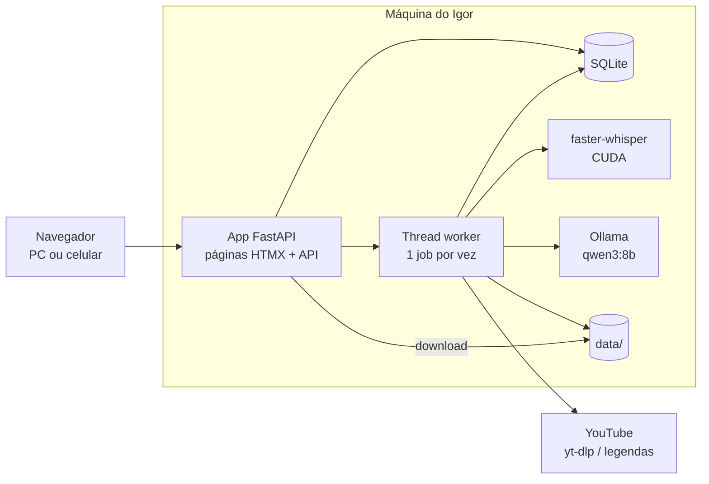
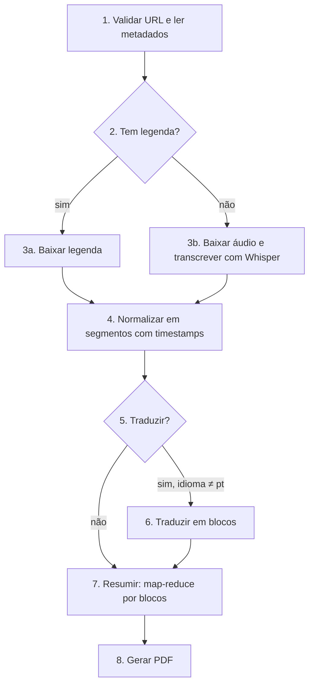

# 02 · Arquitetura

## Premissas

- **Uso pessoal**, rodando **inteiramente na máquina do Igor**, com **custo zero**: nenhuma API paga e nenhum servidor na nuvem.
- Hardware: Intel i7-11700, NVIDIA RTX 3080 (10 GB de VRAM), 32 GB de RAM, Windows (app roda no WSL2).
- Um vídeo processado por vez: a GPU é o recurso disputado, então não há ganho em paralelizar.

## Stack escolhida

| Camada | Escolha | Por quê |
|---|---|---|
| Linguagem | Python 3.12 | Melhor ecossistema para áudio, Whisper e `yt-dlp` |
| Sistema | **Windows com WSL2 (Ubuntu)** | CUDA, ffmpeg e WeasyPrint instalam sem atrito; a GPU funciona dentro do WSL2 |
| Aplicação web | FastAPI servindo páginas Jinja2 + HTMX | Um único processo, sem build de frontend, sem Node |
| Fila de jobs | Tabela `jobs` no SQLite + **uma thread de worker** no mesmo processo | Sem Redis, sem Docker obrigatório; um job por vez na GPU |
| Download de vídeo/áudio | `yt-dlp` + `ffmpeg` | Padrão de mercado, mantido ativamente |
| Legendas existentes | `youtube-transcript-api` | Evita transcrever quando o YouTube já tem legenda |
| Transcrição de áudio | `faster-whisper` com **`large-v3-turbo` em CUDA, float16** | Qualidade próxima do `large-v3` e bem mais rápido; cabe com folga na 3080 |
| Tradução e resumo | **LLM local via Ollama**, modelo padrão **`qwen3:8b`** (quantização Q4_K_M) | Grátis, roda na GPU, bom em português; `gemma3:12b` como alternativa de mais qualidade |
| Cliente de LLM | Interface `LLMClient` com implementação `OllamaClient` (e `AnthropicClient` opcional) | Permite trocar para uma API paga no futuro mudando só `LLM_PROVIDER` |
| PDF | Jinja2 (HTML) + WeasyPrint | Layout com HTML/CSS |
| Banco de dados | SQLite | Arquivo único, nada para administrar |
| Armazenamento | Disco local (`./data/<video_id>/`) | Simples; limpeza automática dos áudios |
| Acesso pelo celular (opcional) | Tailscale (plano gratuito) | Acessar o app de fora de casa sem abrir portas no roteador |

Alternativas consideradas estão em [04-decisoes.md](04-decisoes.md).

## Uso da GPU

Whisper e o LLM não ficam carregados ao mesmo tempo. O worker executa as etapas em sequência e libera a VRAM entre elas:

| Fase | O que ocupa a VRAM | Uso aproximado |
|---|---|---|
| Transcrição | `faster-whisper` `large-v3-turbo` float16 | ~3–4 GB |
| (descarrega o Whisper) | — | — |
| Tradução e resumo | `qwen3:8b` Q4_K_M + cache de contexto (8–16k tokens) | ~6–8 GB |
| Fim do job | Ollama chamado com `keep_alive: 0` para descarregar o modelo | 0 |

Assim a GPU fica livre quando o app não está processando (útil se a máquina também é usada para jogos ou outras tarefas).

### Tempo estimado na RTX 3080

Estimativas a confirmar com medições reais na Etapa 1 e 2, para um vídeo de **1 hora**:

| Etapa | Com legenda do YouTube | Sem legenda |
|---|---|---|
| Transcrição | segundos | ~2–5 min (Whisper) |
| Tradução para português | ~4–8 min | ~4–8 min |
| Resumo | ~1–3 min | ~1–3 min |
| PDF | segundos | segundos |

## Visão de componentes



## Pipeline de processamento

Cada etapa lê o artefato da anterior e grava o seu próprio em `data/<video_id>/`. Assim, uma falha na etapa 5 não obriga a baixar e transcrever de novo.



| Etapa | Entrada | Saída (em `data/<video_id>/`) |
|---|---|---|
| 1. Metadados | URL | `metadata.json` (id, título, canal, duração, idioma, miniatura) |
| 3a/3b. Transcrição | id do vídeo | `transcript.raw.json` |
| 4. Normalização | raw | `transcript.json` (lista de segmentos `{start, end, text}`), `transcript.txt`, `transcript.srt` |
| 6. Tradução | `transcript.json` | `transcript.pt.json`, `.txt`, `.srt` |
| 7. Resumo | transcrição (original ou traduzida) | `summary.json` |
| 8. PDF | `metadata.json` + `summary.json` (+ transcrição opcional) | `report.pdf` |

### Vídeos longos (limite de contexto)

- **Transcrição:** o Whisper processa o áudio inteiro em streaming; não há limite prático além de tempo de CPU.
- **Tradução:** a transcrição é dividida em blocos de ~1.000 palavras (tamanho pensado para o contexto de um modelo local de 8B), respeitando o fim de frases. Cada bloco é traduzido com as últimas frases do bloco anterior como contexto, para manter coerência de termos. Os timestamps são preservados porque a tradução é feita por segmento numerado.
- **Resumo:** estratégia map-reduce. Cada bloco gera notas parciais (map); depois as notas são consolidadas em um resumo final (reduce). Vídeos curtos (< ~5 mil palavras) vão em uma única chamada; acima disso, map-reduce.

### Formato do resumo (`summary.json`)

```json
{
  "titulo": "string",
  "resumo_curto": "1 parágrafo",
  "resumo_detalhado": ["parágrafos"],
  "ideias_principais": [{"ideia": "string", "explicacao": "string", "timestamp": "00:12:34"}],
  "conceitos": [{"termo": "string", "definicao": "string"}],
  "citacoes": [{"texto": "string", "timestamp": "00:45:10"}],
  "acoes_ou_aprendizados": ["string"]
}
```

O Ollama é chamado com `format` apontando para o JSON Schema deste modelo (saída estruturada), e o backend valida com Pydantic antes de gerar o PDF. Se a validação falhar, tenta de novo até 2 vezes.

### Estrutura do PDF

1. Capa: título do vídeo, canal, link, duração, data de geração.
2. Resumo curto.
3. Ideias principais (com link clicável para o momento do vídeo: `https://youtu.be/<id>?t=<segundos>`).
4. Resumo detalhado.
5. Conceitos e definições.
6. Citações marcantes.
7. Anexo opcional: transcrição completa (original e/ou traduzida).

## API

| Método | Rota | Descrição |
|---|---|---|
| `POST` | `/api/videos/preview` | Recebe `{url}`, devolve metadados (título, duração, miniatura, tem legenda?) |
| `POST` | `/api/jobs` | Recebe `{url, traduzir: bool, gerar_pdf: bool, incluir_transcricao_no_pdf: bool}`, cria job e devolve `{job_id}` |
| `GET` | `/api/jobs/{job_id}` | Status (`pendente`, `baixando`, `transcrevendo`, `traduzindo`, `resumindo`, `gerando_pdf`, `concluido`, `erro`), progresso em %, mensagem de erro |
| `GET` | `/api/jobs/{job_id}/transcricao?idioma=original\|pt&formato=json\|txt\|srt` | Transcrição |
| `GET` | `/api/jobs/{job_id}/resumo` | `summary.json` |
| `GET` | `/api/jobs/{job_id}/pdf` | Download do PDF |
| `GET` | `/api/jobs` | Histórico |

As páginas HTML usam as mesmas rotas por baixo. Atualização de progresso: HTMX faz polling a cada 2 s.

## Modelo de dados

```
Video
  id (youtube video id, PK)
  titulo, canal, duracao_segundos, idioma_original, miniatura_url
  tem_legenda: bool
  criado_em

Job
  id (uuid, PK)
  video_id (FK → Video)
  opcoes (json: traduzir, gerar_pdf, incluir_transcricao_no_pdf)
  status, progresso (0–100), etapa_atual, erro
  fonte_transcricao ('legenda_youtube' | 'whisper')
  tokens_entrada, tokens_saida (custo de LLM)
  criado_em, atualizado_em, concluido_em

Artefato
  id, job_id (FK), tipo ('transcricao'|'traducao'|'resumo'|'pdf'), idioma, formato, caminho, tamanho
```

Cache: se já existe uma transcrição para o mesmo `video_id`, o novo job reaproveita e pula as etapas 1–4.

## Estrutura de pastas do repositório

```
transcriptor/
├── app/
│   ├── main.py             # FastAPI: páginas + API, inicia a thread do worker
│   ├── web/                # rotas das páginas e templates Jinja2/HTMX
│   ├── api/                # rotas JSON
│   ├── core/               # config (pydantic-settings), logging
│   ├── db/                 # modelos SQLAlchemy + SQLite
│   ├── pipeline/
│   │   ├── youtube.py      # validar URL, metadados, legendas, download de áudio
│   │   ├── transcribe.py   # faster-whisper (carrega, transcreve, descarrega)
│   │   ├── normalize.py    # segmentos, txt, srt
│   │   ├── chunking.py     # divisão em blocos
│   │   ├── translate.py    # tradução via LLM
│   │   ├── summarize.py    # resumo map-reduce via LLM
│   │   ├── pdf.py          # Jinja2 + WeasyPrint
│   │   └── runner.py       # orquestra as etapas, grava progresso
│   ├── llm/                # LLMClient, OllamaClient, prompts versionados
│   ├── worker.py           # thread que consome a tabela jobs
│   ├── templates/pdf/      # HTML/CSS do PDF
│   └── cli.py              # CLI: transcriptor <url> [--traduzir] [--pdf]
├── tests/
├── docs/                   # esta documentação
├── data/                   # saídas (fora do git)
├── scripts/                # iniciar.sh / iniciar.bat
├── pyproject.toml
├── .env.example
└── README.md
```
